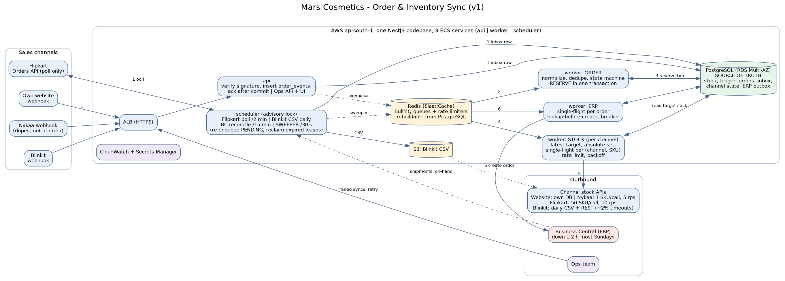

# Mars Cosmetics: Order & Inventory Sync Service (v1 design)

**Stack:** Node.js / NestJS (TypeScript), PostgreSQL (RDS), Redis (ElastiCache, BullMQ), AWS ECS.



## 1. Architecture

One NestJS codebase and image, deployed as **three ECS services**: `api` (webhooks, ops API/UI), `worker` (BullMQ processors for orders, per-channel stock, ERP) and `scheduler` (Flipkart poll, Blinkit CSV, Business Central (BC) reconcile, sweeper; one active instance via a Postgres advisory lock). A modular monolith suits 3 developers and 6 weeks, and roles still scale separately.

**PostgreSQL is the only source of truth; Redis only wakes workers up.** Every unit of work (inbox event, stock push, ERP call) is a row with a status, a lease (`locked_until`) and an attempt count. Jobs are enqueued after commit. A 30-second **sweeper** re-enqueues `PENDING` rows and reclaims rows whose lease expired (crashed worker). Losing Redis loses nothing.

**Flow:** (1) webhook/poll result is written to `order_events`, acked after commit. (2) order processor dedupes and applies the state machine. (3) one transaction reserves stock and writes ledger, channel accounting, targets and the ERP outbox row. (4) stock workers push targets. (5) ERP worker creates the order in BC. (6) scheduler pulls shipments and on-hand from BC.

Peak is 300 orders/min, about 5/s and about 10 line updates/s. One Postgres primary handles this; the hot path is one indexed `UPDATE` per line.

## 2. Data model

| Table | Key columns / constraints |
|---|---|
| `sku_stock` | `sku` PK, `on_hand`, `reserved`, `version`, `sell_rate`; `CHECK (reserved >= 0 AND on_hand >= reserved)` |
| `orders` | `id` PK, `channel`, `external_order_id`, `status`, `source_updated_at`; **`UNIQUE(channel, external_order_id)`** |
| `order_items` | PK `(order_id, sku)`, `qty`, `unit_price` |
| `order_events` (inbox) | `channel`, `dedupe_key`, `type`, `event_time`, raw `JSONB`, `status`, `locked_until`, `attempts`; **`UNIQUE(channel, dedupe_key)`** |
| `stock_ledger` (append-only) | `sku`, `reason` (RESERVE, RELEASE, DISPATCH, RECEIPT, ADJUST, RECONCILE), deltas, before/after, `order_id`, `actor`, `ts`; **`UNIQUE(idempotency_key)`** |
| `channel_stock_state` | PK `(channel, sku)`, `mode` (SHARED/TAIL), `share_qty`, `consumed_qty`, `target_qty`, `target_version`, `computed_at`, `pushed_qty`, `pushed_version`, `status`, `locked_until`, `attempts`, `next_attempt_at`, `last_error` |
| `stock_push_log` (append-only) | `channel`, `sku`, `qty`, `version`, `result`, `http_status`, `ts` |
| `erp_outbox` | `order_id`, `seq`, `type` (CREATE/CANCEL), `status`, `locked_until`, `attempts`, `erp_doc_no`; **`UNIQUE(order_id, seq)`** |
| `channel_cursor` | `channel` PK, `cursor` (updated_ts, id), `observed_through` (watermark) |

**Indexes:** partial indexes on `status IN ('PENDING','RETRY')` ordered by `next_attempt_at`, and on `locked_until` for lease reclaim, for `order_events`, `channel_stock_state` and `erp_outbox`; `stock_ledger(sku, id)`.

**No duplicate orders**, three layers: unique `(channel, dedupe_key)` on events (provider event ID, else `sha256(channel|order_id|type|source_updated_at)`), unique `(channel, external_order_id)` on orders, unique ledger `idempotency_key` (a retried transaction cannot reserve twice).

**Order states:** `RESERVED → DISPATCHED → RETURNED`; `RESERVED → CANCELLED`; `STOCK_SHORT → CANCELLED_BY_US`. Only forward transitions apply.

## 3. Order ingestion

- **Webhooks:** verify signature, `INSERT ... ON CONFLICT DO NOTHING`, return 200 after commit; on DB failure return 5xx so the channel retries. Enqueue is best effort (sweeper backs it up).
- **Flipkart polling:** every 2 minutes, cursor `(updated_ts, id)` with a 10-minute overlap (dedupe makes overlap harmless). Persist each page before advancing the cursor; never skip a failed page. An hourly job re-reads the last 24 h to catch late or missed orders.
- **Duplicates (Nykaa):** no-ops, still acked. **Out of order:** events older than `source_updated_at` or non-forward are stored and ignored. **Cancel before create:** the cancel inserts the order directly as `CANCELLED`; the late create sees a terminal state and reserves nothing.
- **Channel down:** if Flipkart's `observed_through` lags by more than 5 minutes, its published stock for tail SKUs drops to 0 until it catches up (stop selling what we cannot see). Webhook channels retry on non-2xx (A4); `api` runs 2+ tasks across AZs.

## 4. Inventory consistency

**Key fact:** a marketplace order arrives *after* the customer has bought, so reservation cannot reject it; it can only record it or mark it short. **Reservation is the correctness boundary** (stock never goes negative, exactly one order wins the last unit). **Overselling is prevented by what we advertise**, and a channel exceeding its advertised share is *not* rejected; only insufficient global stock is.

**Reservation transaction** (one savepoint around the whole loop, so a short order releases every line):

```text
BEGIN
  insert order_events ON CONFLICT DO NOTHING; duplicate -> COMMIT
  o = upsert orders FOR UPDATE; stale/terminal -> mark processed, COMMIT
  SAVEPOINT reserve_order
  for line in lines sorted by sku:
    row = UPDATE sku_stock SET reserved = reserved + :q, version = version + 1
          WHERE sku = :s AND on_hand - reserved >= :q
          RETURNING on_hand, reserved           -- row lock serializes concurrent orders
    if no row: ROLLBACK TO reserve_order; o.status = STOCK_SHORT; ops alert; COMMIT
    insert stock_ledger(RESERVE, before/after, key = order:line:RESERVE)
    UPDATE channel_stock_state SET consumed_qty = consumed_qty + :q
          WHERE channel = :c AND sku = :s       -- accounting only; never rejects
  o.status = RESERVED; insert erp_outbox(order, seq=1, CREATE)
  recompute_targets(skus)   -- sets mode, shares, target_qty, target_version, computed_at
COMMIT        -- then enqueue; sweeper covers a failed enqueue
```

**What each channel is shown.** `available = on_hand - reserved`, `N = 4` channels, `cap` = display cap (e.g. 20).

- **Shared mode** when `available >= B + N × cap`: every channel shows `cap`. Even if all four sell their full display, `N × cap` units go and the reserve `B` is untouched, so exposure is bounded by construction. Healthy SKUs therefore rarely need a push.
- **`B`** is the reserve for sales we have not yet observed: `B = ceil(1.5 × sku_sell_rate × L)` with `L` the worst observation delay of any channel (Flipkart about 3 min). It is an estimate with a margin, not a proof; the hard guarantee comes from tail mode below.
- **Tail mode** (`available < B + N × cap`): each channel gets a `share_qty`, weighted by 7-day channel sales, with **invariant `Σ remaining_share <= available`**, where `remaining_share = share_qty - consumed_qty`. A channel sells at most its share, so two channels cannot sell the same unit. If a channel's `consumed_qty` overruns its share (late order), the order is still accepted if global stock exists, and **other channels' shares are lowered immediately** in the same transaction to restore the invariant. Cancellations go to a free pool that is re-partitioned only after all lowered values are acknowledged and one lag period has passed. Stranding is bounded to `B + N × cap` units per SKU.

**Stale absolute pushes (the in-flight problem).** A marketplace may already have sold units we have not ingested; pushing "set to N" would overwrite its local decrement and re-expose them. Rules: (1) **decreases push immediately; increases (or re-pushes of an unchanged value) wait until the channel's `observed_through` is at or beyond the target's `computed_at`** (Flipkart: poll cursor; webhook channels: assumed delivery lag of 30 s, A4); (2) pushes are single-flight per `(channel, sku)` and use compare-on-`target_version`, so an old worker cannot overwrite a newer target. **Limit:** without a channel-side conditional update, unobserved sales cannot be bounded to zero, so shared mode is probabilistic and tail mode plus held increases is what we rely on for the last units. We measure the residual (§7).

**Last unit, two channels, same second.** `available = 1`: tail mode, Nykaa holds the only share, others show 0. The realistic failure is a stale display: a website sale 30 s ago left 1 unit and the lowering push has not yet landed, so Nykaa and Flipkart both still show 1 and both sell. Order A runs the conditional `UPDATE`: row lock, `1 - 0 >= 1`, success, `reserved = 1`. Order B waits on that lock, re-evaluates `1 - 1 >= 1`, gets 0 rows, is saved as `STOCK_SHORT` (no ledger row, ops alert); all channels are pushed 0. Ops cancels B on the channel panel (A6) and it counts against the 0.5% budget (80,000 orders × 0.5% = 400). The DB guarantees one winner and no negative stock; shared-mode reserve and tail shares keep the loser rare.

**Cancel/return.** Before dispatch: release once (unique ledger key) and enqueue ERP `CANCEL` (seq 2). On dispatch (BC shipment poll): `on_hand -= q, reserved -= q`. Post-dispatch returns add to `on_hand` only after a receipt is entered (ops screen or BC), then become sellable. **`on_hand` changes only via ledger entries** (DISPATCH, RECEIPT, ADJUST); a 15-minute BC on-hand pull is a drift check writing `RECONCILE` rows and alerting on large drift.

## 5. Stock push within 60 seconds

Under **normal load** the target is 60 s from ingestion to acknowledged push. The queue carries `(channel, sku)`; the worker reads the latest target, sends an absolute value, and records `pushed_version` on ack. Rapid changes coalesce (100 → 95 → 90 sends one call). Dirty rows go **lowest published quantity first**.

| Channel | Limit | Operate at | Notes |
|---|---|---|---|
| Nykaa | 1 SKU/call, 5 rps | 4 rps = **240 SKU/min** | bottleneck: a full 1,200-SKU refresh takes 5 min, so it runs nightly only |
| Flipkart | 50/call, 10 rps | 8 rps = 400 SKU/s | never the bottleneck; honour `Retry-After` on 429 |
| Blinkit | REST + daily CSV, ~2% timeouts | 5 concurrent (A7) | CSV is generated just before upload; afterwards every row with `target_version` newer than the CSV snapshot is re-pushed by REST |
| Website | own DB | n/a | read live from `sku_stock` |

Per-channel queues and rate limiters stop a slow channel blocking others. **Saturation limit:** Nykaa holds 60 s only while fewer than about 240 distinct SKUs change per minute. Because shared mode shows a constant `cap`, only SKUs in tail mode generate Nykaa calls; on sale bursts we serve low-stock SKUs first and expose per-channel freshness (§7). Flipkart cannot meet 60 s end to end (2-minute polling); that delay is part of `L`.

## 6. Failure handling

| Case | Behaviour |
|---|---|
| 429 | Honour `Retry-After`, delay the job, no attempt counted. |
| Timeout / 5xx (Blinkit ~2%) | Exponential backoff with jitter (2 s doubling to 5 min). Absolute values make repeats safe. |
| Stuck or crashed worker | Leases: `locked_until` is set when a row is taken; the sweeper reclaims expired leases (events, stock, ERP). |
| ERP Sunday downtime | `erp_outbox` stays `PENDING`; circuit breaker opens, probes every minute; backlog drains through a rate limiter, per order in `seq` order with single-flight. A normal 2 h outage is about 700 orders; sale-day worst case about 36,000, so BC must accept 10+ orders/s (A8). |
| ERP exactly once | Stable `MARS-<channel>-<external_order_id>` reference. We rely on BC enforcing a **unique external document number or an idempotent create (A8)**; the worker looks up before creating, and a daily outbox-vs-BC reconciliation catches any stray duplicate or missing order. Lookup alone is not enough (a timed-out create may not yet be visible). |
| 4xx (poison) | No retry; `FAILED` with error, shown in the ops screen. |
| Retries exhausted | Stock: `FAILED`, still retried by sweeper every 5 min. ERP: retried up to 48 h, then `FAILED`. |
| Ops screen | Lists `FAILED`/stuck rows from Postgres. **Retry** sets `PENDING` and enqueues; unique keys make it impossible to double-create. Logged with user ID. |
| Isolation | Queue, limiter and breaker per channel and for ERP; an outage never blocks reservation. |

## 7. Observability and validation

Day-one alerts: (1) `STOCK_SHORT` / orders, rolling 15 min (warn 0.3%, page 0.5%); (2) stock freshness, oldest dirty tail SKU per channel (warn 45 s, page 60 s) and Flipkart poll lag > 4 min; (3) oldest `PENDING` event > 30 s and webhook 5xx rate; (4) ERP backlog count and age (30 min normally, 90 min in the Sunday window); (5) `FAILED` rows and SKUs with BC drift.

**Audit:** "why did SKU X change?" is `SELECT * FROM stock_ledger WHERE sku = X ORDER BY id`; "what did channel Y see?" is `stock_push_log`.

**Validating the 0.5% target** (not claimed, to be measured): before launch, a sale-day simulation with same-SKU bursts, stale displays, Nykaa 429s, Flipkart lag and Blinkit timeouts, reporting `STOCK_SHORT / orders`. Note the units are different: last sale's 900 oversold units versus the 0.5% limit on cancelled *orders*.

## 8. Scope: left out of v1

| Left out | Why |
|---|---|
| Second warehouse | Out of brief; adds a location dimension to every stock row. |
| Auto-cancel on marketplaces | No cancel APIs in the brief; ops cancels manually. |
| Returns inspection workflow | Depends on a warehouse process we do not control; v1 takes a receipt entry. |
| Forecasting / auto-tuned allocation | 7-day sales weights are enough; ML is premature. |
| LLM "why did SKU X oversell" assistant | Ledger and push log already answer it. |
| Partial-line orders | Orders are all-or-nothing; ops decides on `STOCK_SHORT`. |

## 9. Assumptions

**A1** Webhooks signed or token-authenticated; secrets in Secrets Manager. **A2** Channels give a stable order ID and timestamp/version. **A3** Stock APIs take an absolute quantity and are idempotent for the same value. **A4** Webhook channels retry on non-2xx and deliver within about 30 s. **A5** An order is "confirmed" on arrival; average 2 lines/order; sale day 80,000 orders. **A6** Marketplace cancellations are manual. **A7** Blinkit REST has no stated limit; 5 concurrent used. **A8** BC enforces a unique external document number (or idempotent create), accepts 10+ orders/s, and exposes shipments and on-hand via API. **A9** SKU master loaded nightly from BC; one warehouse; IST.

## 10. Trade-offs

| Decision | Chosen | Rejected | Why |
|---|---|---|---|
| Stock exposure | Shared constant `cap` with reserve `B`; partition only the tail | Static per-channel allocation for all stock; one global number everywhere | Static allocation strands stock; one number everywhere caused the last sale's oversell. Tail partition gives a hard guarantee where it matters. |
| Reservation | Atomic conditional `UPDATE` in Postgres | Redis counter or distributed lock | Redis can lose writes on failover; the DB row lock is the single correctness boundary. |
| Queueing | BullMQ + Postgres status rows + sweeper | SQS + outbox relay + DLQs | Redis is already in the stack; fewer parts for 3 devs. Cost: Redis loss means about 30 s catch-up, not data loss. |
| App shape | Modular monolith, 3 services | Microservices | 6 weeks, 3 developers. |
| ERP delivery | Unique external reference + lookup-before-create + reconciliation | "Exactly-once" from queue semantics | No queue gives exactly-once to a third party; receiver-side identity does. |
| Stock updates | Absolute "set to N", increases held until watermark | Delta updates; push everything immediately | Deltas double-apply on timeouts; immediate increases can re-expose unobserved sales. |

**Cost (rough, ap-south-1, ±25%, verify in AWS Pricing Calculator):** ECS ~₹10k, RDS Multi-AZ ~₹12k, ElastiCache ~₹5k, ALB ~₹2.5k, NAT ~₹4k, CloudWatch/S3/Secrets ~₹5k, about **₹40k/month**.

**AI usage:** ChatGPT drafted my first version; Claude reviewed it and helped revise this one. I reviewed and can defend every decision.
